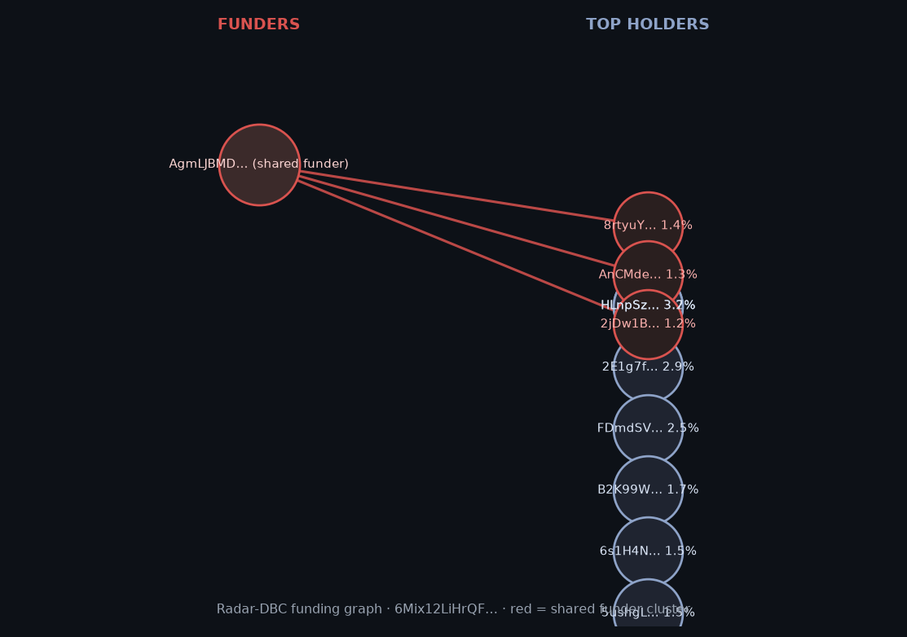

# Radar-DBC 🕸️

**Scan before you farm.** LP safety scoring for Meteora DBC launches.

Part of [Radar](https://github.com/linuxzzz69/radar) — on-chain insider detection for Solana LPs.
Submission: "Best use of Meteora DBC" — Crypto World's Fair sidetrack.

## Live demo (Oct 11, 2026 — five real launches, mainnet)

Five DBC/DYN2 launches scanned in one session with `dbc_scanner.py --graph`:

| Token | Age | Score | Tier | What Radar caught |
|---|---|---|---|---|
| JPAD `4mbP…jupx` | 38h | 62/100 | 🟡 CAUTION | 4 top-holders share one funder, 6.37% of supply linked |
| BORDR `6Mix…ordr` | 74h | 59/100 | 🔴 DANGEROUS | **SPIDER** funder (AgmLJBMDCq…) seeded 3 top-holders, 3.92% supply |
| HOOKED `C1mB…PngE` | 295h | 62/100 | 🟡 CAUTION | 2 funder clusters, 6 holders, **12.11% of supply linked** |
| MINI `Ax5d…jups` | 894h | 59/100 | 🔴 DANGEROUS | **SPIDER again** + second cluster, 5 holders, 8.34% supply |
| EMBER `5dvX…4QEC6` | 749h | 84/100 | 🟢 SAFE | zero funding clusters, contract clean, curve complete |

The headline result: **the same funder wallet (SPIDER, AgmLJBMDCqWynYnQiPCuj9ewsNNsBJXyzoUhD9LJzN51) appears in two "independent" launches** (BORDR, MINI). The scanner re-detected it live, months after its first tracked activity (420+ seeded top-holders). Funding clusters are persistent infrastructure, not one-off events.

Sample output (`python3 dbc_scanner.py 6Mix12LiHrQFojaQEnfPUC65Qkwd6X4Y5Qg93oFbordr`):

```
[funding         ]  8/…  {'linked_wallets': 3, 'linked_pct_supply': 3.92,
                           'clusters': {'AgmLJBMDCq..': ['1.4%', '1.3%', '1.2%']}}
[insider_timing  ] 20/…
[sniper_overlap  ] 11/…
[contract        ]  7/…  {'notes': ['LP only 44% locked']}
[curve_fairness  ]  6/…  {'fee_mode': ''}
[liquidity_health] 10/…  {'curve_progress': 1}

Score: 59/100 — 🔴 DANGEROUS
```

Funding graph (`--graph`), red edges = shared funder cluster:



*(graph files regenerate per scan: `graph_<mint8>.png`)*

## What it does
Before an LP farms a fresh DBC token, Radar answers in 30 seconds: **who really owns this token?**

1. Reads the launch's live DBC state on-chain — `VirtualPool` + `PoolConfig` from the official SDK (`dbc_state.js` microservice): curve phase, anti-sniper fee config, migration progress
2. Traces the token's top holders back to their **first-ever transactions** and clusters wallets sharing a funding ancestor (`dbc_scanner.py`)
3. Prints a **0–100 LP Safety Score** with a per-component breakdown

## Live example
EMBER launch (graduated DBC pool): scored **84/100 🟢** — no funding clusters, contract clean, curve complete. Real output from mainnet today.

In live use this week, Radar's engine caught one funder wallet (1,597 SOL, 20 txs in 2s) seeding top-holders across **5 trending launches**. See the five-launch demo table above (Oct 11 session).

## Architecture
```
dbc_state.js   (Node, official @meteora-ag/dynamic-bonding-curve-sdk)
  └─ HTTP :8077 /state?mint=  → VirtualPool + PoolConfig JSON
dbc_scanner.py (Python)
  ├─ fetches DBC state from :8077
  ├─ funding trace via insider_radar.py engine (RPC, first-tx ancestry)
  ├─ RugCheck contract basics + DexScreener flows
  └─ weighted score: funding 30 | timing 20 | snipers 15 | contract 15 | curve 10 | liquidity 10
```

## Run
```bash
# 1. start the DBC state service
npm install
RPC_URLS="https://api.mainnet-beta.solana.com,https://api.mainnet-beta.solana.com,https://api.mainnet-beta.solana.com" \
  node dbc_state.js
# (public RPCs rate-limit indexed getProgramAccounts; repeat mainnet-beta or a paid key works best)

# 2. score any DBC launch (+ funding graph PNG)
python3 dbc_scanner.py <TOKEN_BASE_MINT> --graph
```

## The stack
- `@meteora-ag/dynamic-bonding-curve-sdk` (official Meteora SDK)
- Solana JSON-RPC (public), RugCheck, DexScreener
- Python 3.10+, Node 18+

Nothing here is financial advice. The contract can't rug you. The holders can. Radar reads the holders.
